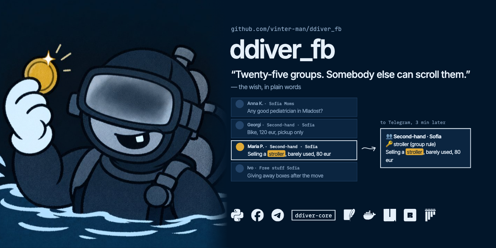
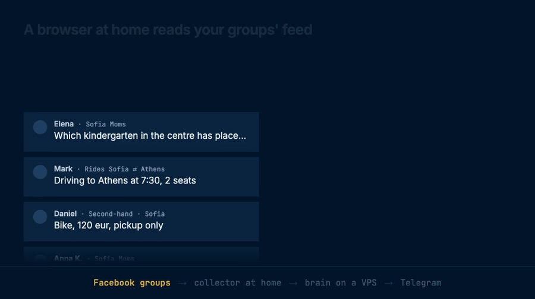
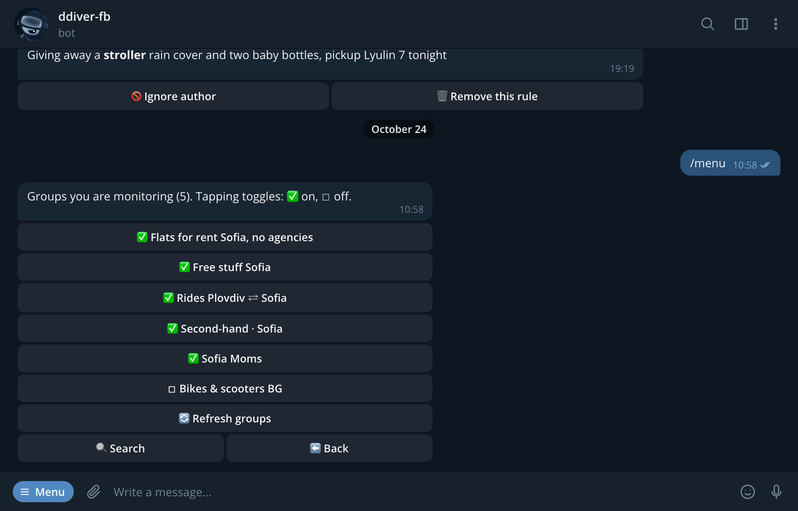
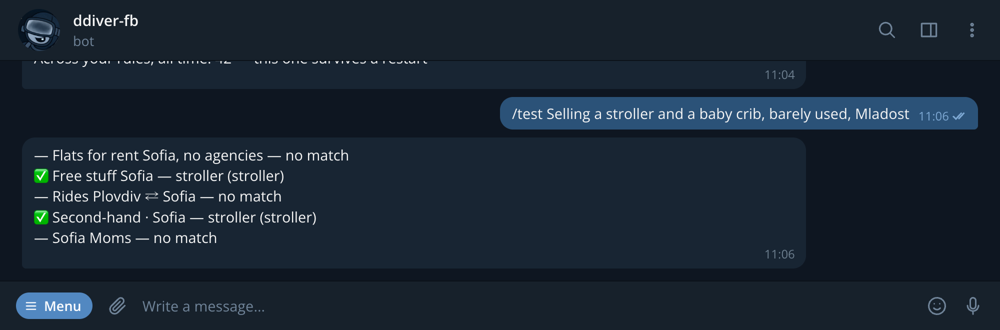
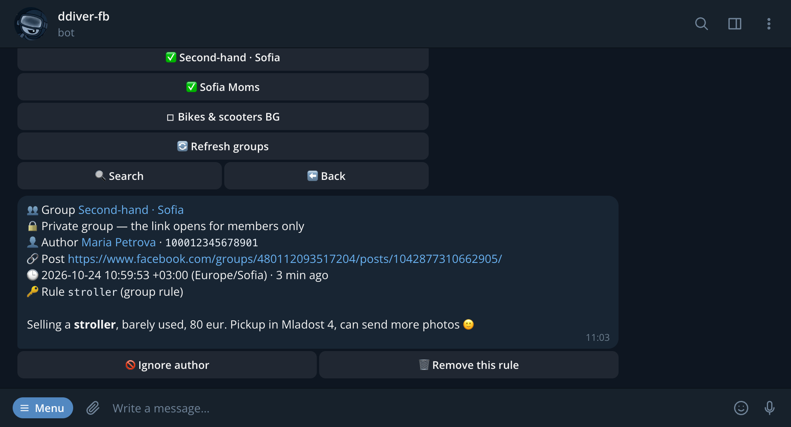
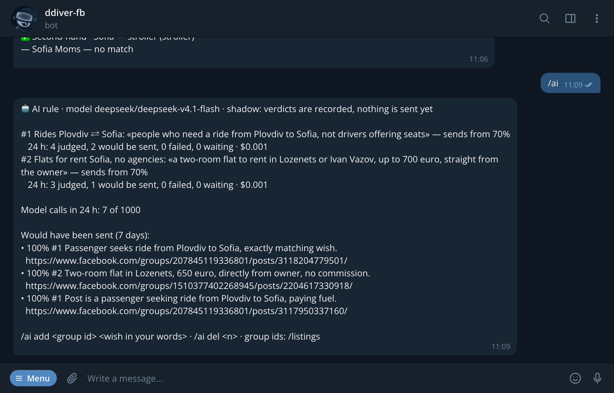
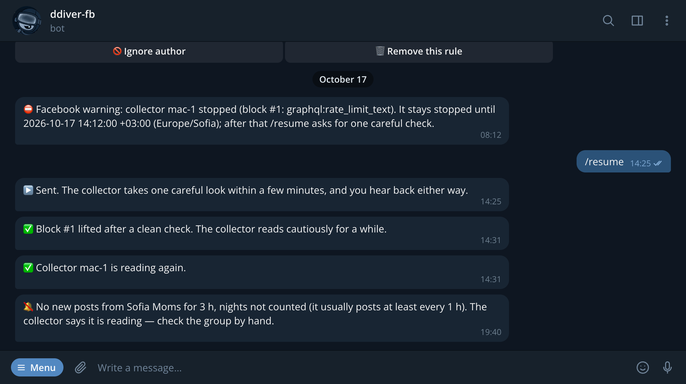
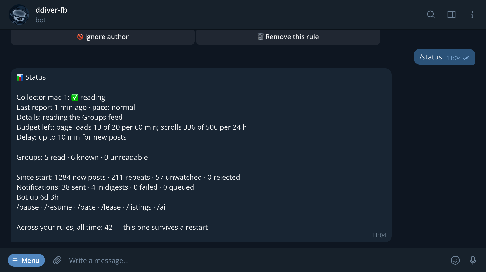

[](https://github.com/vinter-man/ddiver_fb/actions/workflows/ci.yml)


[](LICENSE)



## Short description

A Chrome on a computer at home reads the Facebook groups your account is a member of, the way
you would: the Groups feed, newest first, a page now and then. When a new post matches a rule
you wrote, a Telegram bot writes to you with the group, the author, a link and the text, a few
minutes after the post appeared.

For what keywords can't catch there is a wish in plain words, and a cheap model reads every
post of that group against it.

It is [ddiver](https://github.com/vinter-man/ddiver) for Facebook. The rules, the bot and the
delivery are ddiver's own, shared through `ddiver-core`; what is new is the part that reads
Facebook without ever writing to it, and stops at the first warning.



> :warning: Reading Facebook automatically while logged in breaks Meta's Terms (§3.2), however
> slowly it is done. The realistic worst case is the account being restricted, so use an
> account you can afford to lose, not your main one.

---

## Table of contents

* [User guide](#user-guide)
  * [Pick the groups](#groups)
  * [Write the rules](#rules)
  * [Get the one post that matters](#notification)
  * [Say it in words](#ai)
  * [When something is wrong](#alerts)
* [Installation](#installation)
  * [The brain, on a VPS](#brain)
  * [The collector, at home](#collector)
* [Commands](#commands)
* [Under the hood](#hood)
* [Contact](#contact)

---
---

## <a name="user-guide"></a> User guide

### <a name="groups"></a> Pick the groups

`/menu` → **👥 Groups**. The list is the account's own memberships, synced from Facebook, so
there is nothing to paste: join a group by hand once, and it shows up here. Tick the ones worth
watching.



Other people can use the same bot. The owner decides which groups they see, and everyone keeps
their own rules, ignore list, language and timezone.

> :suspect: Under the hood the brain keeps every group with its state: `member`, `unverified`,
> `left` or `lost`. A group the account can no longer read is paused at once, the owner is told,
> and it stays paused until a sync lists the account as a member again. Only groups somebody
> watches are read at all, and one account reads at most 25 of them: past that, each group's
> backstop read is hours apart (the budget table in
> [DESIGN.md](DESIGN.md#scheduler-budget-and-gates)). `groups.py` and `fbcollector/sync.py`.

### <a name="rules"></a> Write the rules

**🔑 Rules** → *Add*: ddiver's syntax, unchanged. A word, `=exact`, `re:` for a regex, `-word`
to exclude, and `from:` to watch an author by the id every notification shows. `/test` runs
the real pipeline over any text and says, per group, what would fire



> :godmode: A Marketplace card's title, price and location and the text of a shared post are
> added to what the rules see, so `stroller` also catches a listing whose caption says only
> "selling, pickup today". Facebook shows no usernames, so `from:` takes the numeric id or a
> part of the name, and an anonymous participant matches no `from:` rule at all: their name is
> a per-group pseudonym that identifies nobody. `stories.py`, `source.py`.

### <a name="notification"></a> Get the one post that matters



The group, the author with a link to their profile, the post itself, when it was written, and
which rule fired. A private group says that its link opens for members only. Two buttons:
never hear from this author again, or drop the rule.

> :hurtrealbad: Nothing is lost between home and the bot. The collector writes every post it
> parses to its own outbox on disk first; the brain takes posts in batches over the tunnel and
> acknowledges each one only after every notification for it is written to ddiver's outbox. A
> crash on either side means a resend, and a resend is recognised by `(group, post)` and
> dropped. A post that turns up a day late, because an admin approved it late, says so
> (`⏳ Posted 30 h ago, appeared in the group only now`). Subscribing never backfills old posts.
> `ingest.py`, `source.py`, `fbcollector/uplink.py`.

### <a name="ai"></a> Say it in words

Keywords are bad at "people who need a ride, not drivers who offer one": both posts say
*Plovdiv*, *Sofia* and *seat*. So the owner can give a group a wish in their own words

```
/ai add 207845119336801 people who need a ride from Plovdiv to Sofia, not drivers offering seats
```

and every new post of that group goes to a model that answers how likely it fits, in percent,
and why. `/ai` shows the wishes, what they cost, and what would have been sent



It runs in shadow for now: verdicts are recorded, nothing is sent yet, so a wish can be watched
for a few days before it is trusted.

> :suspect: The model was picked by a bake-off: seven models through OpenRouter on 206 real
> posts from the groups, labelled by hand. DeepSeek V4.1 Flash found every rideshare request
> with no false one, took none of 135 unrelated classifieds, and costs about $0.24 per
> thousand posts. Answers are JSON under a strict schema at temperature 0; an empty one is
> asked again once.
>
> The queue is written in the same step that stores the post, so a post is either judged or
> sent again by the collector. Failed calls back off from a minute to an hour and give up after
> six hours; a daily cap on calls bounds the bill. Post texts and the model's reasons, which
> retell the post, are kept seven days and not logged. `judge.py` knows nothing of Facebook,
> so ddiver can take it as it is. `ai.py`, `judge.py`.

### <a name="alerts"></a> When something is wrong

A collector that reads Facebook has more ways to fail than a bot, and most of them look like a
quiet group. So the owner hears about each one, once



and `/status` says what the collector is doing right now, what is left of its budget and how
late a new post may be



> :rage1: The collector only trusts a page that proves it is fine: logged-in markers present
> and no checkpoint, login redirect, rate limit, unknown dialog or empty viewer anywhere in it.
> Anything else stops reading at once, and the stop is written down before Chrome closes. A
> warning opens a block: six hours, then a day, then three days, then until a person re-plans
> it at the collector. When one ends, `/resume` asks for one careful look, and only a clean look
> lifts it. An advanced-protection lock is never probed at all until the owner says, from the
> collector's own browser, that Facebook lifted it.
>
> A group that goes quiet gets its own alert: no post for three times its usual daytime gap
> (two hours at least), nights not counted. A read of the group's own page down to its last
> known post resets the count, because then the group really is quiet and the feed is not
> hiding it. `detectors.py`, `ladder.py`, `monitor.py`.

---
---

## <a name="installation"></a> Installation

You need four things:

* a computer at home that stays on, macOS or Linux, with Google Chrome
* a Facebook account that is a member of the groups (see the warning above)
* a small VPS with Docker for the brain and the bot
* a bot token from [@BotFather](https://t.me/BotFather), an `api_id` and `api_hash` from
  [my.telegram.org](https://my.telegram.org), and your own Telegram user id

The two halves talk over an ssh tunnel that the home machine opens, so nothing at home listens
on the internet, and the VPS never touches facebook.com.

### <a name="brain"></a> The brain, on a VPS

```bash
git clone https://github.com/vinter-man/ddiver_fb && cd ddiver_fb
cp .env.example .env          # BOT_TOKEN, API_ID, API_HASH, OWNER_ID, INGEST_TOKEN
GIT_SHA=$(git rev-parse HEAD) docker compose build
docker compose up -d
docker compose logs -f
```

The build fetches `ddiver-core` from GitHub over ssh, so run it with an ssh-agent that holds a
GitHub key; the Dockerfile's header says why and how. The ingest API is published on
`127.0.0.1:8781` only, for the tunnel to reach. Open the bot and press **Start**.

### <a name="collector"></a> The collector, at home

Install [uv](https://docs.astral.sh/uv/) once; it brings the right Python with it. Put
`FBC_TIMEZONE=<your zone>` into the collector's `secrets` file
(`~/Library/Application Support/fbcollector/secrets` on a Mac) first.

```bash
git clone https://github.com/vinter-man/ddiver_fb && cd ddiver_fb
uv sync
uv run fbcollector pin-home   # remembers the home network; away from it nothing is read
uv run fbcollector login      # opens the collector's own Chrome; you log in by hand
uv run fbcollector run
```

The login is the one moment a person types into that browser, and the profile it creates is
never copied anywhere. The first days after a login the collector reads slowly on purpose.
Until the tunnel and the three `FBC_INGEST_*` settings point it at the brain (RUNBOOK,
section 9), it reads in local mode and keeps what it finds to itself.

> :rage1: On a Mac it runs best under its own Standard macOS user, so its Chrome never shares a
> screen with yours: `deploy/macos/setup-fbc-user.sh` sets that up, with a LaunchAgent for the
> collector and one for the tunnel. Linux gets systemd units in `deploy/linux`. The whole path,
> from the pre-login checklist to the switch to the brain, is in
> [docs/RUNBOOK.md](docs/RUNBOOK.md).

---
---

## <a name="commands"></a> Commands

| Command | What it does |
|---|---|
| `/menu` | groups, rules, ignore list, settings, status |
| `/test <text>` | runs the real pipeline over that text and says, per group, whether it would notify you |
| `/status` | what the collector is doing, its budget, the delay, counters |
| `/export` / `/import` | your groups and rules as a file, and back; import adds rather than replaces |
| `/help` | the rule syntax, in your language |

The owner also has

| Command | What it does |
|---|---|
| `/pause` / `/resume` | stop reading; resume, or ask for the careful look that ends a block |
| `/pace cautious` | cap the collector at its slow profile |
| `/ai` | wishes in plain words: `add`, `del`, and what they would have sent |
| `/listings <id> on` | read a buy/sell group with Facebook's listings sort as well |
| `/lease <id>` | hand reading over to another collector |

---
---

## <a name="hood"></a> Under the hood

```
Facebook ─→ collector ─→ ssh -L ─→ brain ─→ bot ─→ you
 Groups feed   Chrome at home   tunnel    rules · AI  Telegram
```

The collector drives the installed Google Chrome through
[Patchright](https://pypi.org/project/patchright/), headed, with one persistent
profile. The posts come from the JSON the page itself receives, not from the DOM, which the
detectors look at only for dialogs and login fields. It never writes: no
clicks on posts, no reactions, no joins, no typing. What it does is paced by a budget of page
loads and scrolls, jittered everywhere, with quiet hours at night, breaks, and gates that close
Chrome when the machine leaves home, goes on battery or is about to sleep.

The brain never connects to the home machine. The collector checks in over the tunnel, and the
answer carries everything it must obey: the groups to read, a pause, a pace cap, a resume, and
the lease, so that only one collector reads for an account.

A uv workspace of three packages, plus ddiver's core:

| Package | What is in it |
|---|---|
| `packages/fbcollector/` | everything that touches Facebook: the Chrome driver, parser, scheduler and budget, gates, detectors and the block ladder, group sync, the outbox and the uplink |
| `packages/ddiver_fb/` | the brain: ingest API, groups, lease and control, the monitor and its alerts, the AI rule, the bot's Facebook wording in en/uk/ru |
| `packages/fbwire/` | the wire format both sides share: pydantic models, versioned |
| `ddiver-core` | ddiver's rules, matcher, storage, delivery and bot, pinned to a release tag of the [ddiver](https://github.com/vinter-man/ddiver) repository |

```bash
uv sync
uv run pytest -q          # 2784 tests, no Facebook and no Telegram needed
uv run ruff check . && uv run ruff format --check .
uv run mypy
```

The browser tests run the real driver against a page on 127.0.0.1, in headless Chrome, and are
skipped where Chrome is not installed. The driver refuses any facebook.com address in them
before a request leaves.

> :shipit: [DESIGN.md](DESIGN.md) is the architecture, the invariants and why each decision is
> what it is; [docs/RUNBOOK.md](docs/RUNBOOK.md) is the operator's side. The GIF and the
> screenshots are a [Remotion](https://www.remotion.dev/) project in
> [`docs/remotion`](docs/remotion), but their words are not typed by hand:
> [`tools/readme_shots.py`](tools/readme_shots.py) runs the bot's own code on made-up groups and
> posts and saves what it said.

---
---

## <a name="contact"></a> Contact

GitHub: [vinter-man](https://github.com/vinter-man)

License: [MIT](LICENSE), take it and scroll less
